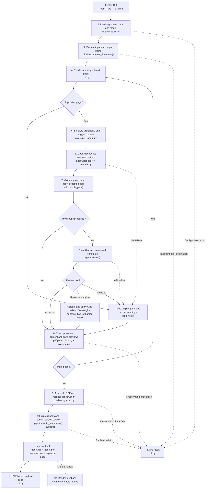

# CLI workflow and code map

The pipeline processes one page at a time. OpenAI proposes and reviews changes; local Python code validates and applies every PDF edit. Rendering provides analysis images and previews. The exported PDF retains its original text and vector geometry.

## Files and functions for each step

All Python modules below are inside `colorblind_assistant/`.

| Step | File and main code | Responsibility |
| --- | --- | --- |
| 1 | `__main__.py`; `cli.py:main()` | Starts `python -m colorblind_assistant` and parses CLI arguments. |
| 2 | `cli.py:main()`; `agent.py:OpenAIReviewer.__init__()` | Reads `.env` from the current directory, gives environment variables precedence, checks credentials, and initializes the API client. |
| 3 | `pipeline.py:process_document()`, `_validate_destination()` | Checks file size, page count, encryption/forms, output collisions, and input protection. |
| 4 | `pdf.py:single_page_bytes()`, `render()`, `inspect_page()`, `text_runs()` | Uses pypdf and PDFium to inventory vector paths, text positions, colors, and stable element IDs; identifies unsupported pages. |
| 5 | `colors.py:simulated_image()`, `simulated_rgb()`, `contrast()`, `color_metrics()`; `agent.py:categorical_color_guidance()` | Runs Viénot protanopia simulation at severity 1.0, calculates contrast/separation heuristics, and offers consistent colors and eligible hatch targets. |
| 6 | `agent.py:OpenAIReviewer.propose()`, `_request()`; `models.py:Action`, `CorrectionGroup`, `PagePlan`, `PageReview` | Sends page images, text, inventory, and palette guidance to OpenAI. Parses a strict structured response. Document contents are treated as untrusted data. |
| 7 | `editor.py:_validate_group()`, `apply_plan()` | Rejects uncertain or invalid groups; checks known IDs, legend consistency, contrast, scale ordering, and placement; applies accepted changes atomically per group. |
| Review/revision | `agent.py:OpenAIReviewer.review()`; `pipeline.py:process_document()` | Reviews the candidate once. Approves it, restores the original, or applies one replacement plan from the original. That revision is flagged for human review. |
| 8 | `pdf.py:assert_preserved()`, `preservation_signature()`; `pipeline.py:process_document()` | Checks original text/geometry operations and page dimensions. Saves original, corrected, and simulated versions of both. |
| 9-10 | `pipeline.py:process_document()`, `write_markdown()`, `_publish()` | Assembles every page, rechecks the export, writes reports from applied changes, and publishes staged outputs with rollback on recoverable publication errors. |
| 11 | `cli.py:main()` | Sends progress to stderr, a JSON result to stdout, and exit codes 0, 1, 2, or 3. |
| 12 | `QA.md`; output `report.json` and `report.md` | Manually records visual checks and reader feedback. Each new CLI run starts with feedback pending. |

## Where the visible corrections are implemented

| Correction | Implementation |
| --- | --- |
| Change fill/stroke colors | `editor.py:apply_plan()` inserts scoped PDF color operations around the existing paint operation. |
| Add diagonal/grid patterns | `editor.py:_hatch_operations()` clips hatch strokes to the original shape and preserves drawing order. |
| Change line style | `editor.py:apply_plan()` inserts dashed or dotted stroke settings. |
| Add an existing source label | `editor.py:_place()` finds nearby whitespace; `_overlay()` draws the copied text using ReportLab. |
| Explain changed color references | `editor.py:_mapping_note()` generates a note from accepted changes; `_place()` and `_overlay()` position and draw it. |

## Supporting files

- `pyproject.toml`: dependencies, package metadata, and the installed `colorblind-assistant` entry point.
- `.env.example`: configuration template. The local `.env` is ignored through `.gitignore`.
- `README.md`: installation, Windows commands, outputs, exit codes, and support limits.
- `QA.md`: automated, visual, live API, and reader-validation evidence.
- `tests/test_pdf.py`: PDF inventory, transformations, preservation, and an independent synthetic fixture.
- `tests/test_editor.py`: bounded edits, contrast, legend checks, placement, and hatch occlusion.
- `tests/test_agent.py`: structured API requests through mocked HTTP, error handling, and palette guidance.
- `tests/test_pipeline.py`: complete processing, reports, CLI codes, configuration, overwrite, and rollback.
- `tests/sample_responses.py`: deterministic test responses for controlled QA only; production uses `OpenAIReviewer`.
- `tests/fixtures/Test_Document_Protanopia.pdf`: the supplied five-page test document.

## Boundaries

An unsupported page remains unchanged and is included in the complete export. An invalid correction group remains unchanged while other validated groups may proceed. API failures retain the affected original page and appear in the report; fatal configuration/API errors stop subsequent API calls. Document-level or preservation failures stop publication.

The loop allows one proposal, one review, and at most one revision per page. Reader feedback is a manual validation step that informs later code changes. A successful processing run does not by itself establish readability for a reader with protanopia.
