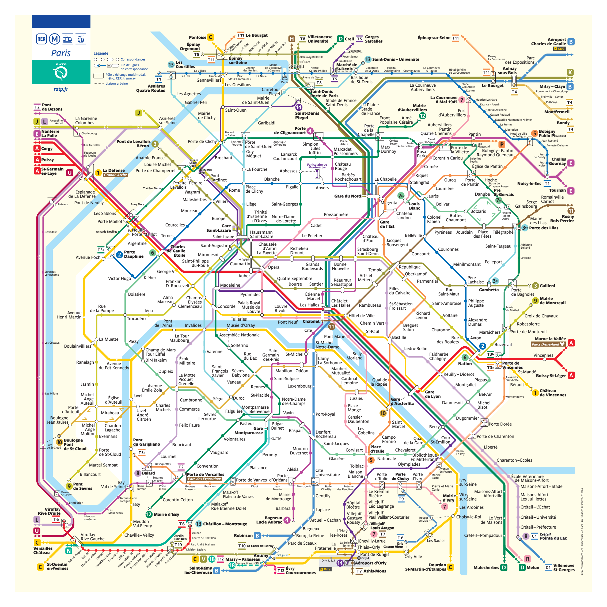
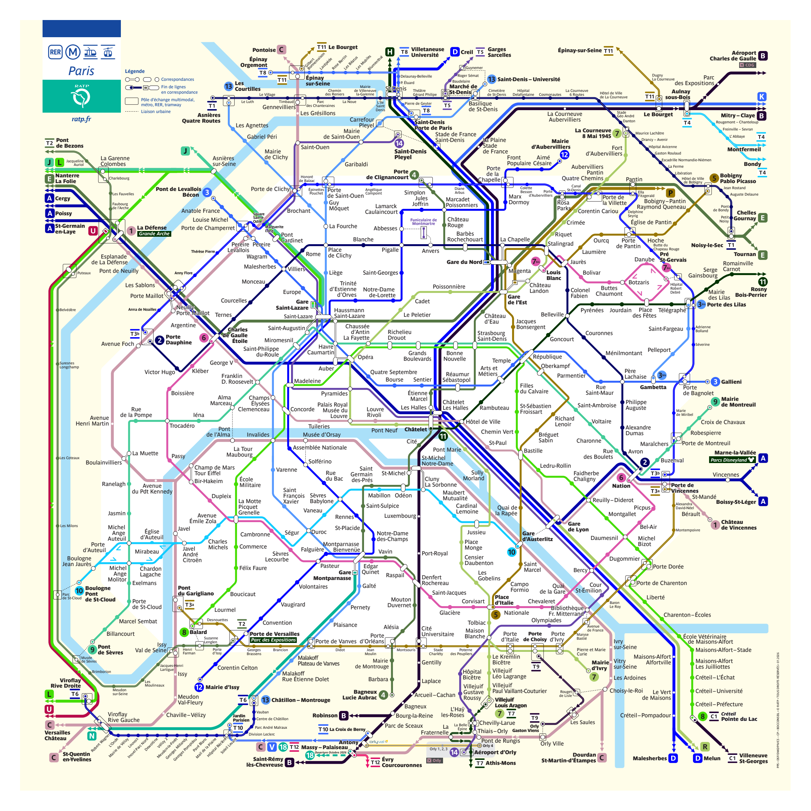
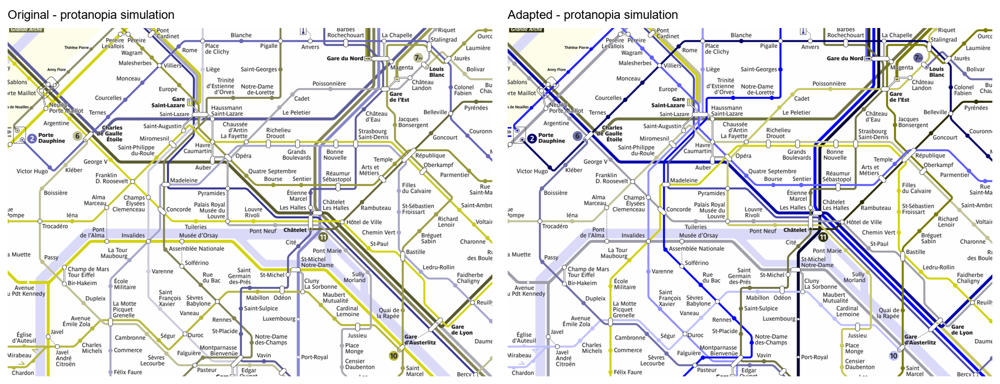

# Colorblind PDF Fixer

A Codex skill for making PDF figures more readable for readers with protanopia. It combines PDF inspection, DaltonLens simulations, evidence-based corrections, and checks that preserve the document's content and layout.

See [SKILL.md](SKILL.md) for the workflow and dependencies.

## Example: Paris metro map

This example was produced by an agent following the skill workflow, with document-specific vector color edits and preservation checks. Route categories were identified from the existing numbers and letters before changing their colors.

### Before and after

Both pages below show normal display colors.

| Original | Adapted for protanopia |
| --- | --- |
|  |  |

### Protanopia simulation

The same central area before and after correction, both simulated with DaltonLens Vienot at severity 1.0. These simulated views illustrate the color distinctions being checked; they are separate from the adapted PDF's actual colors.

### What this example demonstrates

- Recoloring 16 identified palette groups consistently across route paths, station dots, direction arrows, and matching route markers, including related tramway tints and equivalent spot colors.
- Preserving the vector artwork, selectable labels, route connections, and page layout. Text extraction remained identical, and all 3,211 text and drawing objects retained their positions.
- Reviewing ordinary and simulated views, then checking the result with the skill's PDF verifier and additional document-specific preservation checks.

Some routes still share colors, including 6/7bis and 13/3bis. Adapted colors differ from official signage, so use the route numbers and letters to identify services. Reader and physical-print testing were not performed; the simulation is not an accessibility certification.

Map artwork: © RATP, January 2026. The source attribution remains visible in the full-page images. This adapted example is not an official RATP map.
