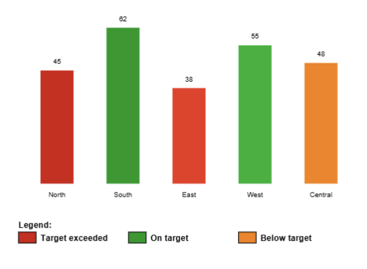

# Correction rules for protanopia

Use the original figure and its DaltonLens protanopia simulation together. The simulation is a likely visualisation of what a person with protanopia will see. Base every correction on the chart's labels, legend, values, and visible relationships; color similarity by itself does not establish meaning. ALWAYS keep the image original intent.

## Recoloring

- Change only categories whose meaning is established by a legend, direct label, or explicit source text.
- Apply one replacement consistently to every matching chart mark and its legend symbol.
- Choose colors that remain distinguishable in the simulation and preserve readable contrast with nearby text and backgrounds.
- Preserve numeric values and category meaning. Do not recolor photographs or colors that are themselves data, such as spectral bands or microscopy channels.
- For a sequential numeric scale, recolor only when the complete key and low-to-high direction are clear. Keep the scale monotonic in lightness and preserve its numeric labels. Do not turn a diverging scale with a meaningful midpoint into a sequential one.

## Non-color cues

- Add diagonal or cross hatching only when the target shape boundary or pixel mask is known. Keep the hatch inside the shape, away from text, and consistent with its legend symbol.
- Change solid lines to dashed, dotted, or dash-dot only when the curve and its legend sample are confidently matched. Give both the same line style.
- Add labels only by copying existing source text or values. Do not invent names, values, or explanations; place labels only where they do not cover chart content.
- If surrounding text names original colors, add a concise mapping note so those words do not contradict the new encoding. Keep the original text intact.

## Uncertain or unsupported figures

Leave a category unchanged when its association or boundary is uncertain. Do not infer a category from color alone. Do not apply hatching or line styles to a raster region unless the implementation provides a reliable mask or path. Record what could not be safely changed.

# For charts  

## For category charts (bar, pie, column, etc.)

- Use a lot hatching and recoloring as they will give the best results. 

## Worked example: categorical bar chart

The paired example in `../assets/examples/` shows the original chart and a supported correction. Categories are established by the legend; the correction applies each color consistently to its bars and legend swatch, then adds hatching as a non-color cue. Keep the values and category meanings unchanged. Treat this as an example, not a fixed palette for other charts.

| Original | Corrected example |
| --- | --- |
|  |  |

## For timeseries charts (line, etc.)

- Use more lines related changes : making the lines dashed, dotted, and dash-dot. 
