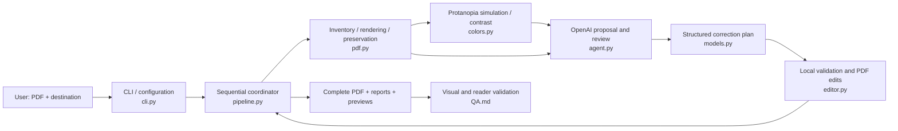

# Project overview and skill migration plan

Status: 24 October 2026. The CLI MVP exists and has been tested in `../cli/`. This `skill/` folder holds the upcoming migration work. The skill migration below is proposed work; no installable skill or plugin is included yet.

## What has been delivered

| Milestone | Delivered behavior | Main files |
| --- | --- | --- |
| 1. PDF foundation | Native text/vector inventory, stable element IDs, rendering, unsupported-page detection, preservation checks. | `pdf.py`, `tests/test_pdf.py` |
| 2. Accessible cues | Validated color changes, hatching, line styles, copied labels, mapping notes, matching chart/legend cues. | `editor.py`, `colors.py`, `models.py`, `tests/test_editor.py` |
| 3. AI workflow | Structured proposals and review, bounded revision, untrusted-document handling, sanitized API failures. | `agent.py`, `models.py`, `tests/test_agent.py` |
| 4. Usable CLI | Sequential pages, private environment configuration, overwrite protection, staged publication, progress and exit codes. | `cli.py`, `pipeline.py`, `pyproject.toml`, `.env.example` |
| 5. Outputs and QA | Complete PDF, Markdown/JSON reports, four previews per page, five-page and independent synthetic fixtures. | `pipeline.py`, `tests/test_pipeline.py`, `QA.md` |
| 6. Reader-led improvement | Revised palette guidance following a poor first live result; improved status colors and matching patterns. | `agent.py`, `tests/test_agent.py`, `QA.md` |
| 7. Handoff | Windows setup, support limits, architecture diagram, publication review, and this migration plan. | `README.md`, `ARCHITECTURE.md`, `QA.md`, `.gitignore` |

Python module paths in the table are under `../cli/colorblind_assistant/`; tests and CLI documentation are under `../cli/`. The shared `.gitignore` stays at the repository root. Changes were committed locally in coherent milestones for rollback.

The current suite has 30 passing tests. Controlled test responses establish engine behavior; two separate live runs establish that the OpenAI integration works. The first live result failed reader review. The revised live result received positive qualitative feedback from one reader with protanopia, especially on color changes and hatching. It remains a partial correction: East/West bar mappings are uncertain, and final revisions need human review. Identification accuracy and reading time have not been measured.

## Global architecture today



`pipeline.py` owns ordering, failures, one review and at most one revision per page, and safe publication. `agent.py` supplies interpretation; it has no execution tools. `editor.py` accepts only identified elements and supported actions. `pdf.py` verifies original content before publication. Unsupported pages stay in the final document unchanged, with explicit warnings.

Rendering uses PDFium; original vector edits use pypdf; label overlays use ReportLab; protanopia simulation uses DaltonLens. The exported document retains original selectable text and vector geometry. The detailed loop and function map are in [the CLI architecture](../cli/ARCHITECTURE.md).

Supported-page images and extracted text currently go to OpenAI. Local reports and previews also contain document content. `store=False` is an API request setting, not a claim that documents never leave the machine or that all service retention is disabled.

## Target: a skill containing instructions and references

The requested final deliverable can contain only Markdown instructions and references. The host agent then supplies reasoning and execution tools. There is no separate CLI to invoke and no project-specific OpenAI API key. The host's own authentication, billing, file access, tool availability, and data handling still apply.

The skill folder alone cannot edit a PDF. It must run in a host that can read local files, inspect rendered pages, execute PDF transformations, and verify the result. An instructions-only package can ask the host to write temporary code using available PDF libraries. This moves implementation into each execution and reduces reproducibility compared with the tested engine. That tradeoff must pass evaluation before claiming equivalent support.

Suggested final skill contents:

```text
protanopia-documents/
  SKILL.md
  references/
    document-contract.md
    pdf-workflow.md
    color-and-cue-rules.md
    output-contract.md
    validation.md
```

| File | Content to migrate |
| --- | --- |
| `SKILL.md` | Precise discovery description, inputs/outputs, essential constraints, environment check, workflow, and links to references when needed. |
| `references/document-contract.md` | Supported PDF subset, unchanged-region policy, original text/value/geometry requirements, document-as-data boundary. |
| `references/pdf-workflow.md` | Inventory and stable IDs, permitted edits, drawing-order and clipping rules, safe placement, staged publication and rollback. |
| `references/color-and-cue-rules.md` | Viénot severity 1.0, heuristic separation, contrast, matching legends, ordered scales, source-color wording, palette evidence and limits. |
| `references/output-contract.md` | PDF/report/preview filenames, JSON schema and statuses, explanations based only on applied edits; no shell exit-code promise for chat invocation. |
| `references/validation.md` | Preservation checks, visual review of every exported page, reader tasks, unresolved issues, and distinction between processing and readability. |

References should specify behavior and invariants, not hide the whole application as executable code inside Markdown. Keep each rule in one place. Preserve the supported subset until separate tests justify an expansion. Do not install libraries or send documents to new services silently.

## Migration milestones and acceptance gates

| Phase | Work | Done when |
| --- | --- | --- |
| 1. Preserve the baseline | Tag the working CLI version when migration starts. Retain tests, synthetic fixtures, visual evidence, and unresolved issues as the comparison baseline. Keep private run outputs out of distribution. | The baseline can be reproduced independently and remains available for rollback. |
| 2. Extract the skill contract | Draft the six Markdown files above from actual code and QA. Declare the required rendering/execution capabilities. Define unsupported-environment behavior. | Another agent can identify the intended task, required tools, outputs, and refusal-to-guess rules from the skill alone. |
| 3. Transfer orchestration to the host | Use the host agent for proposal and review. As a transitional implementation, expose the existing engine through file-based inventory, plan validation/application, and export operations. Remove nested OpenAI calls from this route. | The host supplies plans and reviews without using this project's API key; deterministic editing and existing regression checks still pass. |
| 4. Trial the strict instructions-only bundle | Remove the transitional engine from the distributed skill. Have the host use its own verified PDF tools or generate temporary code from the references. Keep the CLI baseline outside the bundle for comparison. | Repeated runs preserve text, geometry, page count, chart/legend mappings, numerical order, and placement; missing capabilities lead to an explicit limitation, not a fabricated result. |
| 5. Evaluate portability and readability | Test clean supported Windows and macOS/Linux hosts, varied digital PDFs, unsupported scans/graphics, ambiguous mappings, prompt-like document text, and interrupted writes. Compare reader identification tasks with baseline and original. | Publish a compatibility matrix and measured results; retain all unresolved issues. If preservation gates fail, keep the transition version available and narrow the instructions-only support claims. |
| 6. Package and distribute | Version a folder/ZIP for initial users. For wider OpenAI-host distribution, wrap the single skill in a minimal plugin manifest and publish through the appropriate distribution path. | A new user can install, invoke, run a sample, find the outputs, and see limitations without this checkout, its `.env`, or its conversation history. |

Phase 3 is intentionally transitional and includes code. Phase 4 is the requested final instructions-and-references-only form. Keep the transitional release until the strict form passes the gates; do not delete tested behavior merely to reduce the package to Markdown.

## How users would receive it

For local authoring, place the skill in `.agents/skills/protanopia-documents/` inside a test repository. A user-wide Codex installation can use `~/.agents/skills/protanopia-documents/` (on Windows, under the user's profile). The current official documentation also describes installing a skill from a repository using the skill installer. These are local discovery routes; broad distribution is better served by a plugin. See [Build skills](https://learn.chatgpt.com/docs/build-skills).

For broader installation, a minimal skill-only plugin contains a root `plugin.json` and `skills/protanopia-documents/` with the files above. It needs no MCP server if the supported host provides the required execution tools. Plugin packaging does not provision a Python environment or guarantee that every ChatGPT/Codex surface can execute this workflow. Document and test supported hosts before publishing. See [Package your plugin](https://developers.openai.com/plugins/build/plugins).

Proposed invocation after installation: `Use the protanopia-documents skill to improve this PDF, preserve original text and chart geometry, and save the result and report in a new output folder.`

## What changes in the existing code

| Current component | During transition | Strict final skill |
| --- | --- | --- |
| `cli.py`, `__main__.py`, local `.env` | Keep for CLI rollback; provide a separate host-driven route. | Replaced by the host conversation and tool configuration. |
| `agent.py` OpenAI client | Replaced by host reasoning for the skill route. | No direct project API client or nested model call. |
| `models.py` | Keep machine validation while the engine is present. | Document the plan/report contracts; host must validate generated results. |
| `pdf.py`, `editor.py`, `colors.py` | Keep as deterministic helpers. | Convert their decision rules and preservation checks into references; execution uses host tools or temporary code. |
| `pipeline.py` | Separate reusable processing from model invocation. | Workflow and output requirements move to skill instructions; host must still verify publication and preservation. |
| `tests/`, `QA.md` | Continue regression and reader evaluation. | Retain as maintainer evaluation evidence outside the installed skill, not as claims that every host has passed. |

The next concrete milestone is Phase 1-2: preserve the CLI baseline and draft the skill contract. No new OCR, web UI, additional vision deficiency, hosted service, or custom MCP server is required for that milestone.
